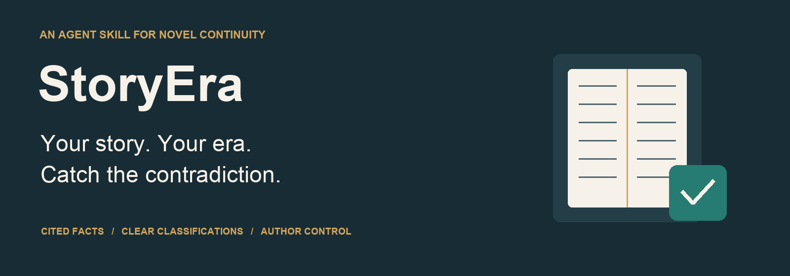
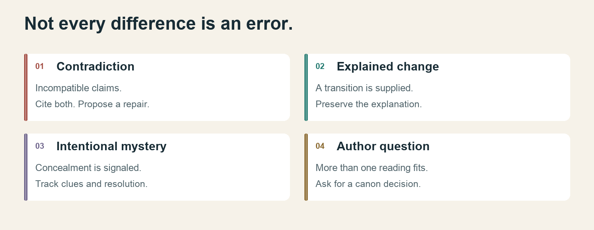
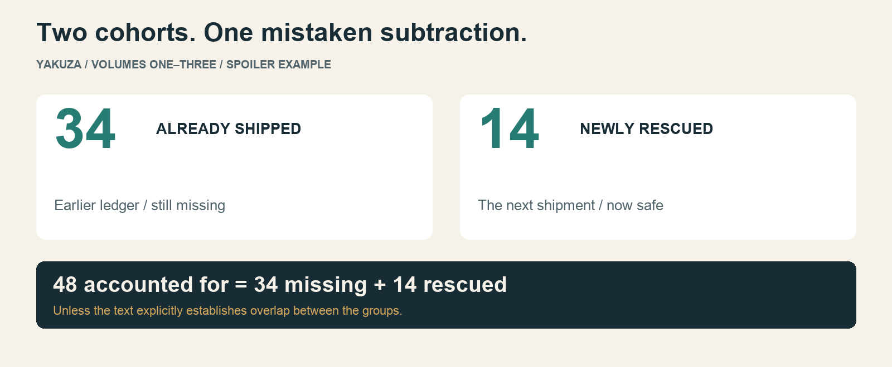
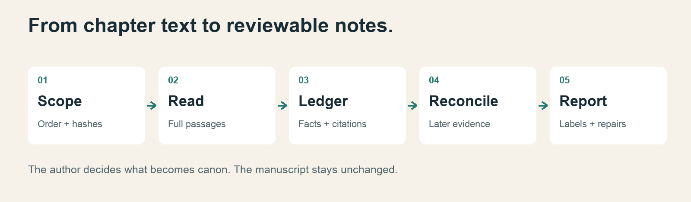

<p align="center"></p>

# StoryEra

**Continuity notes with receipts.** An instruction-only Agent Skill for novels and series. Give your agent Markdown chapters; it builds a cited fact ledger, separates contradictions from mysteries and explained changes, and suggests repairs without editing your manuscript.

[Install](docs/installation.md) · [Use it](docs/usage.md) · [Real novel examples](docs/case-study.md) · [How it was created](docs/creation.md) · [Evaluation](docs/evaluation.md)

No MCP server, model SDK, API key, or web application is required by this package. Your existing agent reads the instructions and performs the audit. Optional Python utilities validate saved reports; they do **not** audit prose themselves. Instruction-only does not mean your agent runs offline.

## A continuity error is not every surprising detail



| Outcome | Example | Response |
| --- | --- | --- |
| Contradiction | An earlier group is confused with a newly rescued group. | Cite both passages and propose a minimal repair. |
| Explained change | A weak character improves through months of training. | Preserve the change and cite the explanation. |
| Intentional mystery | A concealed identity has a signaled later reveal. | Track the clue; disclose whether the resolution was read. |
| Author question | A montage has two plausible chronologies. | Ask which interpretation is intended. |

## Quick start

Clone this repository, then copy the **whole** skill folder into your novel project. Replace the destination with your actual path. The subshell refuses an existing installation, including a dangling symlink.

```sh
git clone https://github.com/kmsmohamedansar/storyera.git
cd storyera
(
  destination="/absolute/path/to/your-novel/.agents/skills/storyera"
  if [ -e "$destination" ] || [ -L "$destination" ]; then
    echo "An installation already exists; review it before updating." >&2
    exit 1
  fi
  mkdir -p "$(dirname "$destination")"
  cp -R skills/storyera "$destination"
)
```

Open the novel project in Codex and ask:

> Use $storyera to audit chapters/01.md through chapters/08.md in that order. Build a cited fact ledger. Separate contradictions, explained changes, intentional mysteries, and author questions. Suggest repairs without modifying the manuscript.

See [installation](docs/installation.md) for personal installation and discovery checks. Local paths follow [official OpenAI guidance](https://learn.chatgpt.com/docs/build-skills), checked October 23, 2026.

## From a real manuscript

**Spoilers for _YAKUZA: The Borrowed Life_, Volumes One–Three, by Mohamed Ansar Kader Meera Sahib.**

The original author supplied the novel for an audit. One finding: the story establishes **34 children already shipped away**, rescues **14 in the next shipment**, but the ending subtracts those fourteen from the original 34.



The [case study](docs/case-study.md) includes exact, source-numbered excerpts, reasoning, proposed repairs, an employment-history contradiction, and examples we would **not** classify as errors. The full novel is not included.

**Evidence status:** the novel audit happened before this repository's installable skill existed; it followed a README-described workflow. This is a curated demonstration, not a blind benchmark or a measured accuracy rate. See [creation history](docs/creation.md) and [evaluation](docs/evaluation.md).

## How it works



The instructions live in [SKILL.md](skills/storyera/SKILL.md). The [JSON contract](skills/storyera/references/report-format.md) supports saved reports. Core instructions are provider-neutral; `agents/openai.yaml` adds optional Codex display metadata.

## Try the small fictional sample

Use [evals/prompts.md](evals/prompts.md). Four original chapters include contradictions, an identity puzzle, an explained change, an uncertain claim, and an embedded instruction that must remain manuscript data.

Development checks require Python 3.9+ with its standard library only:

```sh
python3 -m unittest discover -s tests -v
python3 evals/grade.py /absolute/path/to/report.json --scenario full
```

The grader checks structure, quotes, line ranges, scope, and seeded classifications. It cannot prove reasoning quality, good repairs, exhaustive coverage, or manuscript preservation. See [evaluation](docs/evaluation.md).

## Repository map

```text
skills/storyera/       Copy this folder to install
docs/                    Installation, usage, origin, case study, evaluation
docs/assets/             Original PNG diagrams and SVG sources
examples/manuscript/     Fictional regression manuscript (MIT)
examples/yakuza/         Selected author-authorized excerpts (rights reserved)
evals/                   Prompts, grader, fixtures, run records
tests/                   Offline regression tests
scripts/                 Packaging and documentation-image utilities
```

## Limits and rights

This is model guidance, not a deterministic continuity engine. It may miss errors, misread intent or lose evidence in a long context. Human authors decide canon and repairs. No universal model performance is claimed.

The skill, code, original diagrams, general documentation and fictional regression sample are MIT licensed. **YAKUZA excerpts and case-study prose are excluded from MIT and remain the author's copyright**; see [LICENSE](LICENSE) and [example rights](examples/yakuza/RIGHTS.md). Using the skill grants no rights to a user's manuscript.

[Contribute](CONTRIBUTING.md) · [Package boundaries](docs/packaging.md)
